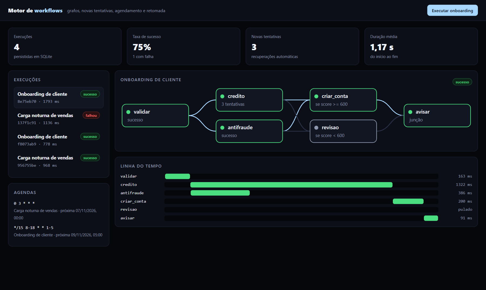
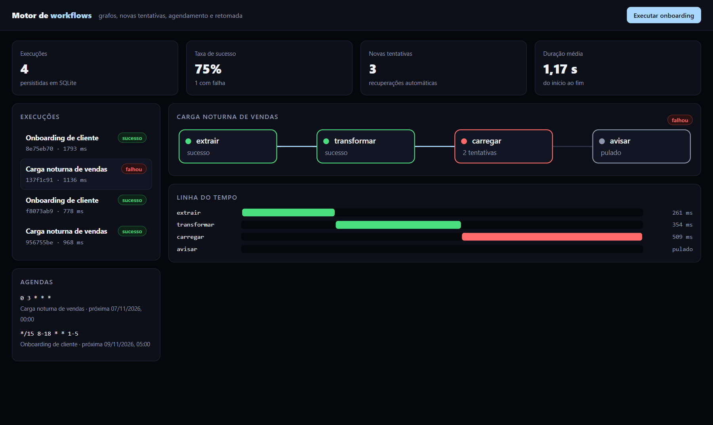
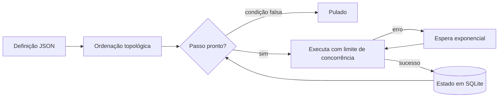
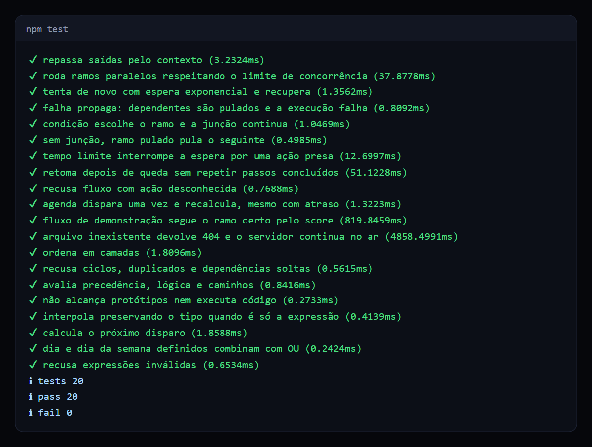

# Motor de workflows

Motor de automação baseado em grafos, com execução paralela, novas tentativas, agendamento e retomada depois de uma queda.

   

## Veja funcionando



*Onboarding real: a consulta de crédito falhou duas vezes e se recuperou na terceira, enquanto o antifraude rodava em paralelo. O ramo de revisão foi pulado pela condição do score.*



*Quando um passo esgota as tentativas, os dependentes são pulados e a execução termina como falha, sem esconder o erro.*

## O problema

Toda empresa tem processos com várias etapas: cadastrar um cliente, rodar uma carga noturna, emitir uma cobrança. Em script, esses processos quebram mal. Uma API fora do ar derruba tudo, uma queda obriga a recomeçar do zero e ninguém sabe em que etapa parou.

## O que ele faz

- **Fluxos em grafo:** passos declarados em JSON, com dependências validadas (ciclos e referências soltas são recusados).
- **Paralelismo controlado:** passos independentes rodam juntos, respeitando um limite de concorrência.
- **Novas tentativas:** espera exponencial e tempo limite por passo.
- **Condições e junções:** ramos ativados por expressão e pontos de encontro entre ramos.
- **Retomada:** depois de uma queda, a execução continua de onde parou, sem repetir passos concluídos.
- **Agendamento:** expressões cron com faixas, listas e passos.
- **Painel:** grafo colorido por estado e linha do tempo de cada passo.

## Como funciona

Um fluxo é só um dado:

```json
{
  "id": "criar_conta",
  "acao": "criar_conta",
  "depende": ["credito", "antifraude"],
  "se": "passos.credito.saida.score >= 600",
  "params": { "cliente": "{{ entrada.cliente }}" }
}
```



O escalonador olha o estado de cada passo e inicia todos os que têm as dependências resolvidas. Cada mudança é gravada antes de seguir, e é isso que torna a retomada possível.

## Decisões técnicas

| Decisão | Motivo |
| --- | --- |
| Avaliador de expressões próprio | Definições de fluxo nunca passam por `eval`, e o acesso a protótipos é bloqueado. |
| Ordenação pelo algoritmo de Kahn | Detecta ciclo e gera as camadas do desenho com a mesma passagem. |
| Passo interrompido volta para a fila | Garante pelo menos uma execução, então as ações precisam ser idempotentes. |
| Agenda atrasada dispara uma vez só | Depois de horas parado, o motor não dispara dezenas de execuções acumuladas. |
| Relógio e espera injetáveis | Testes de novas tentativas rodam sem esperar de verdade. |

## Como rodar

Requer Node.js 24. Não há dependências para instalar.

```bash
npm start     # painel em http://localhost:3000
npm test      # 20 testes
```

## Testes



Incluem queda simulada com retomada em um novo processo, pico real de concorrência, cron em ano bissexto e tentativa de acessar `constructor` por expressão.

## Limites conhecidos

- O motor roda em um único processo. Para vários trabalhadores, os passos iriam para uma fila com reserva por tempo.
- O tempo limite abandona a espera, mas não cancela a ação em andamento. Isso exigiria `AbortSignal` em cada ação.
- O cron trabalha em UTC.

## Estrutura

```text
src/motor.ts       escalonador, tentativas, retomada e agendas
src/grafo.ts       validação e ordenação topológica
src/expressao.ts   tokenizador e avaliador por descida recursiva
src/cron.ts        interpretador e cálculo do próximo disparo
src/demo.ts        fluxos e ações de exemplo
public/            painel com grafo em SVG
```

## Sobre este projeto

Projeto de demonstração, com dados e empresas fictícios, criado para mostrar a abordagem técnica.

## Autor

**Luiz Renato Carvalho**, Engenheiro de Software e IA · [luizrenato.dev](https://www.luizrenato.dev) · [LinkedIn](https://linkedin.com/in/luizrenatodc)
